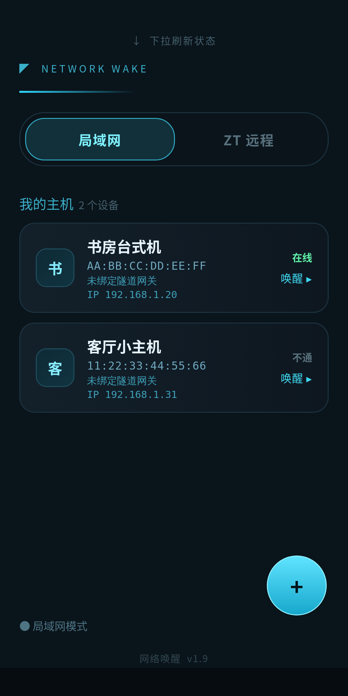
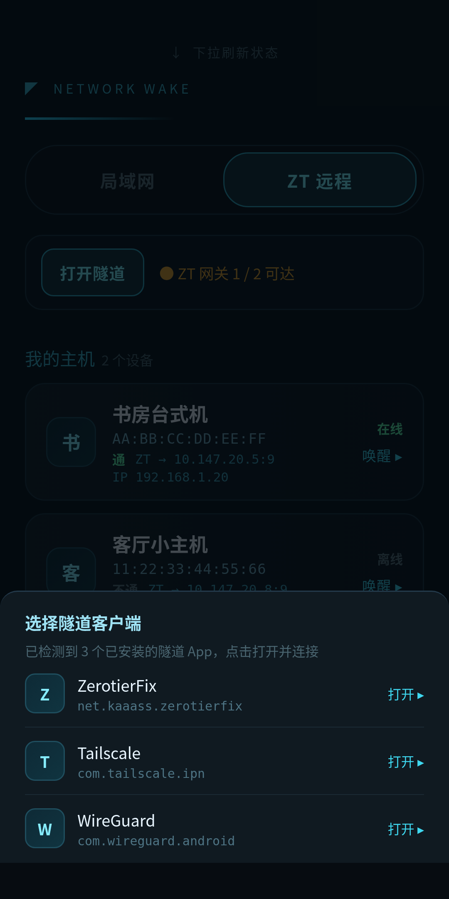
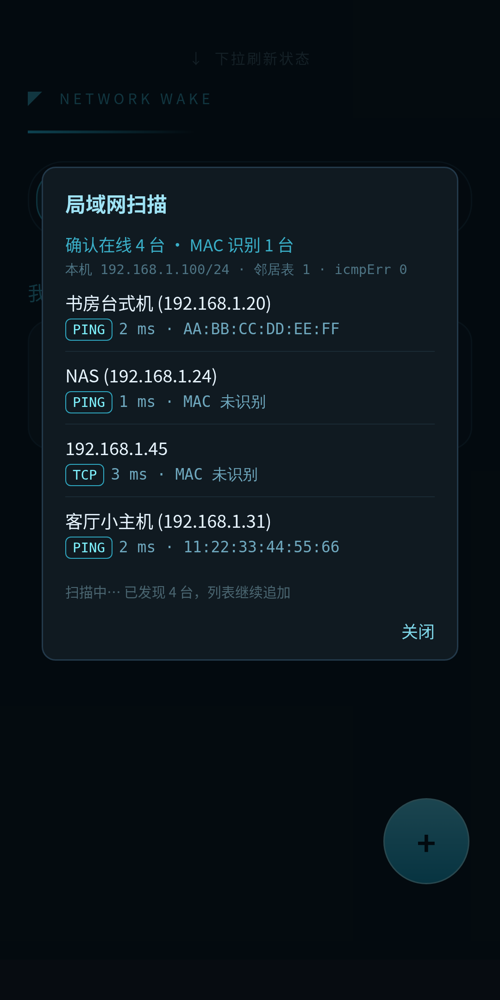
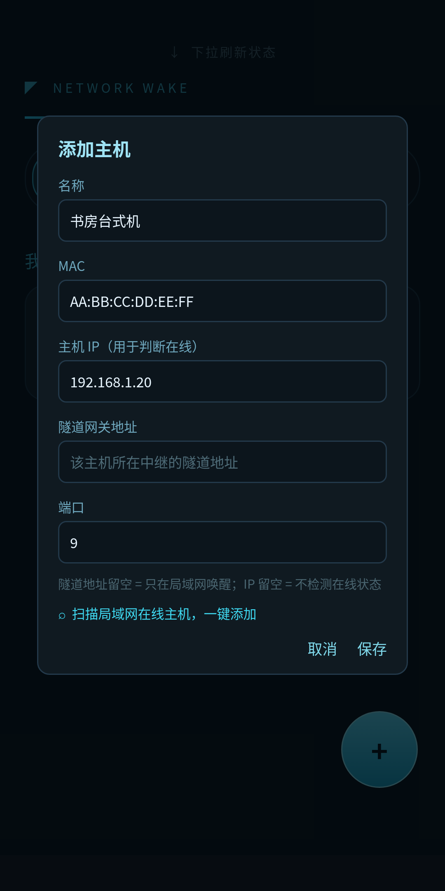

English | [简体中文](README.zh-CN.md)

# ZT Wake — Wake-on-LAN over any remote tunnel

An Android **Wake-on-LAN** client with both **LAN wake** and **remote wake over a tunnel**. Built for the case where you have no public IP and no desire to open port forwards: your phone is outside, and a single layer-3 tunnel wakes the machine at home.

> **Not tied to ZeroTier, and not tied to OpenWrt.**
> A magic packet is always the same 102 bytes. Any layer-3 tunnel (ZeroTier / Tailscale / WireGuard / frp / public-IP mapping) plus one always-on box will do.

The UI is hand-written with native Views, zero third-party dependencies, APK about 200 KB.

## The problem it solves

A magic packet is a **layer-2 broadcast frame**: 6 bytes of `FF` followed by the target MAC repeated 16 times, 102 bytes total, sent to UDP port 9.

- Broadcast inside the same subnet → works.
- Over ZeroTier or any layer-3 tunnel → **broadcast does not traverse it**, the host never sees the packet.

So let a device that is **always on and attached to the target LAN** (router / NAS / Raspberry Pi) take the unicast packet and re-broadcast it locally:

```
Phone app  →  tunnel  →  always-on relay  →  LAN broadcast  →  target NIC  →  power on
```

No public port exposed, no special firmware required.

## Up and running in three steps

1. **Relay side** (OpenWrt, or any Linux with socat):
   ```sh
   opkg install socat          # use your distro's package manager otherwise
   cp openwrt/wolrelay /etc/init.d/wolrelay && chmod +x /etc/init.d/wolrelay
   /etc/init.d/wolrelay enable && /etc/init.d/wolrelay start
   logread -t wolrelay         # expect: listen <tunnel addr>:9 -> <LAN broadcast>:9
   ```
2. **Phone**: install the APK, switch to "ZT Remote", tap **"Open tunnel"** — the app lists the tunnel clients installed on the phone (ZeroTier / ZerotierFix / Tailscale / WireGuard / OpenVPN) and lets you pick one. Once connected, the header `ZT gateways x / y reachable` turns green.
3. **Add a host**: name, MAC, LAN IP, and the relay's tunnel address (port 9 by default). Tap the card to wake.

## Features

- **Two modes**: LAN wake (direct broadcast) / **remote wake over a tunnel** (send to the relay, the relay broadcasts)
- **Any tunnel**: not bound to ZeroTier; "Open tunnel" enumerates installed tunnel clients for you to choose
- **Host cards**: custom name, MAC, LAN IP, per-host gateway address and port; tap the card to wake
- **Online status**: ICMP → port handshake → fast RST → NetBIOS, multi-stage detection, parallel probing, results in about 1 second; pull-to-refresh shows `probing … n / m`
- **LAN scan**: range computed from the real netmask, rows appear as they are found, router-generated false positives filtered out
- **Hostname resolution**: system PTR → mDNS → HTTP `<title>`, three-level fallback
- **Gateway status**: gateway addresses on the cards are de-duplicated, header shows `x / y reachable`, each card shows `up / up·refused / down`
- **Native ICMP**: `native/nbl.c` implements ICMP echo (works with normal app permissions), multi-threaded without cross-talk

## Screens

<table>
<tr>
<td><br/><b>LAN mode</b><br/>main list, tap a card to wake</td>
<td><br/><b>ZT Remote</b><br/>"Open tunnel" + gateway reachability</td>
<td><br/><b>LAN scan</b><br/>rows appear while scanning</td>
</tr>
<tr>
<td><br/><b>Add host</b><br/>name · MAC · IP · gateway · port</td>
<td></td><td></td>
</tr>
</table>

*Rendered from the app's real layout and colors; host names, MACs and IPs are placeholder data.*

## Layout

```
src/com/zt/wol/MainActivity.java   UI: list, scan, probe, wake
src/com/zt/wol/NetHelper.java      JNI entry points
native/nbl.c                       netlink neighbour table + ICMP echo
libs/                              prebuilt libnbl.so (arm64-v8a / armeabi-v7a)
openwrt/wolrelay                   relay: socat UDP forwarder (procd service, auto-detects zt*/tailscale*/wg*, auto-computes broadcast)
docs/                              tunnels, relay devices, troubleshooting, limits
```

## Documentation

Every document is available in English (default) and Simplified Chinese.

- [OpenWrt walkthrough (with the pitfalls hit for real)](docs/router-openwrt-example.md) — feed replacement, socat, self-looping, boot ordering, port conflicts
- [Feiniu NAS (fnOS) as a relay](docs/nas-fnos.md) — Debian 12, SSH, systemd, Docker
- [Any layer-3 tunnel](docs/tunnel.md) — how to wire Tailscale / WireGuard / frp / public-IP mapping
- [Relay devices and router configuration](docs/router.md) — requirements, firmware support matrix, per-platform commands
- [Troubleshooting](docs/troubleshooting.md)
- [Known limitations](docs/limitations.md)
- [Tech notes (pitfall log)](docs/tech-notes.md)

## Building

Needs JDK 17, Android SDK Platform 33, Build-Tools 33.0.2; editing `native/nbl.c` additionally needs NDK r26+.

```sh
aapt2 compile --dir res -o build/res.zip
aapt2 link -I $ANDROID_JAR --manifest AndroidManifest.xml --auto-add-overlay \
    --min-sdk-version 21 --target-sdk-version 28 --java build/gen -o build/base.apk build/res.zip
javac -source 8 -target 8 -encoding UTF-8 -cp $ANDROID_JAR -d build/classes \
    build/gen/com/zt/wol/R.java src/com/zt/wol/MainActivity.java src/com/zt/wol/NetHelper.java
d8 --lib $ANDROID_JAR --min-api 21 --output build/ build/classes/com/zt/wol/*.class
# add classes.dex and lib/<abi>/libnbl.so into base.apk, zipalign, then sign with your own keystore
```

`build.sh` wraps the same pipeline end to end.

## Security

- The tunnel approach exposes no port to the internet;
- Public IP + UDP mapping means port 9 is open to the world — restrict the source or change the port;
- The relay does no authentication (UDP has no handshake). **"Who can get into your tunnel" is the security boundary.**

## License

MIT, see [LICENSE](LICENSE).
